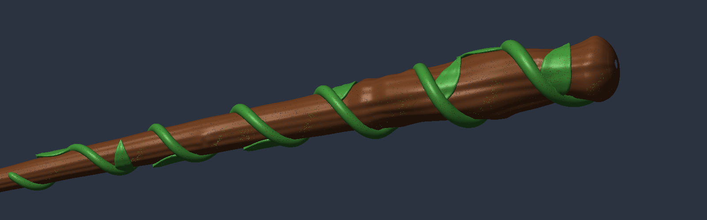

# Vine Wand

A wooden wand with a leafy vine wrapped around it, ready for a two-colour print.

| File | What it is |
| --- | --- |
| `vine_wand.3mf` | One object, two parts: **wand** (brown) and **vine** (green). Open this in Bambu Studio, OrcaSlicer or PrusaSlicer. |
| `wand_brown.stl` | The wood only. |
| `vine_green.stl` | The vine and leaves only. Load both STLs together as one multi-part object if your slicer prefers STLs. |
| `make_wand.py` | The script that builds all of the above (`pip install numpy scipy trimesh manifold3d`, then `python3 make_wand.py`). |

Size: 240 × 24 × 25 mm, so it fits a 256 mm bed lying flat.

## Printing

1. Open `vine_wand.3mf`. If the slicer asks whether to load it as a single object with multiple parts, say **yes**.
2. Give the `wand` part a brown filament and the `vine` part a green one.
3. Print it lying flat, as it loads, with **tree supports** (the wand is round, and the leaf tips lift slightly off the bark).
4. 0.16–0.2 mm layers and 3 walls work well. A 0.4 mm nozzle handles the thinnest parts: the leaf edges are about 0.9 mm and the vine tip is 1.3 mm across.

The vine is cut out of the wood, so the two parts touch exactly and never overlap.
